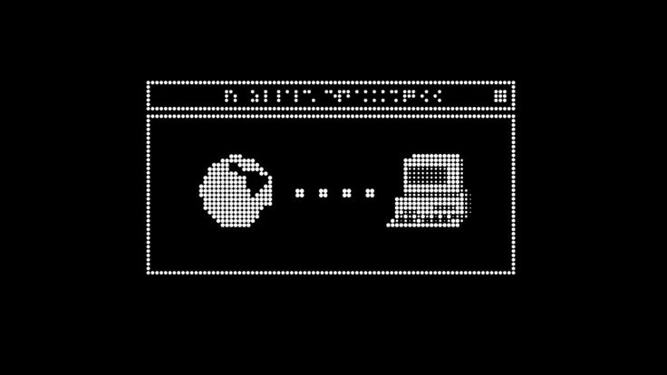

<!-- ============ HEADER BANNER ============ -->

<h1>
  
</h1>

 

<!-- ============ ABOUT ME ============ -->

## ✦ About Me

<table>
<tr>
<td width="35%" align="center">
  
</td>
<td width="65%" align="center">

Hello! My name is **Esha Abbasi**, and I am a **Software Engineer** from Bahrain 🇧🇭 with a degree in Information Technology and a **Full-Stack Developer** who loves building complete web applications, from database to deployment.

I work with the **MERN stack**, build **CRUD APIs with FastAPI**, and develop with **PHP & Laravel**. I enjoy turning ideas into live, deployed products, from magical marketplaces to volunteering platforms.

</td>
</tr>
</table>

 

<!-- ============ LANGUAGES ============ -->

## ✦ Programming Languages

## ✦ Frameworks & Libraries

## ✦ Stacks & Concepts

## ✦ Databases

## ✦ Hosting & Deployment

## ✦ Version Control

## ✦ Tools

 

<!-- ============ DINO DIVIDER ============ -->

  

 

<!-- ============ PROJECTS ============ -->

## ✦ Featured Projects

<table>
<tr>
<td width="50%" valign="top">

### ⚡ Weasleys' Wizard Wheezes
*A Harry Potter themed multi-vendor marketplace*

A full e-commerce platform where wizarding shop owners sell products and customers browse, buy and review them.

- 🔐 JWT auth with **3 roles**: Admin, Shop Owner, Customer
- 🏪 Shop approval workflow enforced server-side
- 🛍️ Cart, stock limits and mock checkout with order tracking
- 🖼️ Multi-image uploads for products and reviews

 

</td>
<td width="50%" valign="top">

### 📚 LitCritique
*A social book review platform*

A server-rendered app where readers log, share and discover book reviews and leave reading notes on any page.

- ✏️ Full **CRUD** with owner-only edit and delete
- ⭐ Favorites list and search by title, author, genre or status
- 💬 Reading notes from any logged-in user
- 🔑 Session authentication with bcrypt

 

</td>
</tr>
<tr>
<td width="50%" valign="top">

### 🤝 Tatawwu'
*Volunteering in Bahrain* · Team project

A bilingual (English / Arabic) platform connecting volunteers with charitable campaigns across Bahrain.

- 🧑‍💼 Organizers publish campaigns; admins review and approve
- ✅ Attendance tracking and downloadable PDF certificates
- 🗺️ Interactive maps and RTL Arabic support
- 🔐 JWT authentication with Volunteer, Organizer and Admin roles

  

</td>
<td width="50%" valign="top">

### 🔥 Burn & Run
*A browser dodging game*

A cannon fires fireballs at you. Dodge them, build your score and beat the clock to win.

- 🎮 Easy and Hard modes with extra obstacles
- 🎵 Background music and game-over sound effects
- ⏱️ Score target and countdown timer
- 🧑 Player name entry and a retry flow

 

</td>
</tr>
</table>

 

<!-- ============ STATISTICS ============ -->

## ✦ Statistics

  

 

<!-- ============ HOBBIES & GOALS ============ -->

## ✦ Hobbies & Goals

🎯 **Goal:** Keep growing as a well-rounded, production-ready software engineer.
🎧 **Hobbies:** Coding, reading, music, pixel art

*"The best way to learn is to build."*

 

  

  

